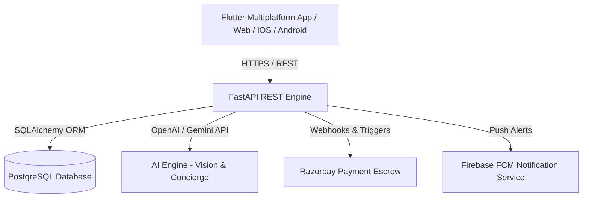

# 📚 LibriFlow — Next-Gen AI Book Exchange & Smart Library Platform

> **Empowering Communities to Discover, Borrow, Share, and Monetize Physical & Digital Reading Collections with AI Intelligence.**

---

## 🌟 Executive Overview

**LibriFlow** is an enterprise-ready, full-stack multiplatform ecosystem designed to revolutionize peer-to-peer book sharing, rentals, and community library management. Built with a high-performance **FastAPI** backend and a responsive **Flutter multiplatform** mobile & web client, LibriFlow combines physical book logistics with cutting-edge AI assistance.

---

## ✨ Core Platform Capabilities

- 🤖 **AI Study & Reading Concierge**: Personalized book discovery, instant AI vision ISBN scanner, and study plan generator.
- 💳 **Escrow & Wallet System**: Integrated transaction escrow, wallet top-ups, rental payouts, and security deposit management via Razorpay.
- 🛡️ **Safe Exchange Zones**: Geofenced drop-off points and secure handoff tracking for peer-to-peer physical book rentals.
- 🏅 **Gamification & Reading Passports**: Milestone badges, reading streak tracking, and verifiable reader activity passports.
- 📊 **Enterprise Admin Dashboard**: Operational analytics, user verification, order lifecycle management, and platform commission tracking.

---

## 🏗️ System Architecture



---

## 📂 Repository Architecture

```
libri-flow/
├── .github/                  # CI/CD workflows for Automated Testing & Linting
├── backend/                  # FastAPI REST Service & Engine
│   ├── alembic/              # Database schema migrations
│   ├── app/                  # Main Python package
│   │   ├── api/              # REST Endpoints (Auth, Books, Cart, Orders, AI)
│   │   ├── core/             # Configuration, Database Sessions, Security
│   │   ├── models/           # SQLAlchemy Data Models
│   │   └── schemas/          # Pydantic Request & Response Models
│   ├── scripts/              # Database Seeding & Maintenance Utilities
│   ├── tests/                # Pytest Suite (Unit, Integration & API)
│   └── Dockerfile
├── frontend/                 # Flutter Multiplatform Client App
│   ├── assets/               # Branding assets, icons & fonts
│   ├── lib/                  # Feature-First Architecture
│   │   ├── core/             # Routing, Theme, Services, Tokens
│   │   └── features/         # Domain Modules (auth, books, cart, wallet, etc.)
│   └── pubspec.yaml
├── docs/                     # Product Architecture & Typography Documentation
├── scripts/                  # Developer Automation Scripts
├── docker-compose.yml        # Local Stack Orchestration (PostgreSQL + FastAPI)
├── Makefile                  # CLI Task Automation
└── README.md                 # Product Specification & Developer Documentation
```

---

## 🚀 Quickstart Guide

### Prerequisites
- [Docker & Docker Compose](https://www.docker.com/)
- [Python 3.11+](https://www.python.org/)
- [Flutter SDK 3.11+](https://flutter.dev/)

---

### Option A: Running with Docker (Recommended)

Start the full database, backend service, and database administration dashboard in one command:

```bash
docker compose up -d
```

- **FastAPI API Documentation**: `http://localhost:8000/docs`
- **Adminer Database Manager**: `http://localhost:8080`

---

### Option B: Local Developer Commands

Using **Makefile**:
```bash
make dev            # Start local stack via Docker
make test           # Run backend & frontend test suites
make seed           # Populate database with initial catalog
```

Using **PowerShell (Windows)**:
```powershell
.\scripts\task.ps1 dev
.\scripts\task.ps1 test
.\scripts\task.ps1 seed
```

---

## 🧪 Testing & Quality Assurance

Run the comprehensive test suite before submitting pull requests:

```bash
# Run Backend Pytest Suite
cd backend && pytest tests/ -v

# Run Frontend Flutter Analyzer & Tests
cd frontend && flutter analyze
```

---

## 📄 License & Contact

Copyright © 2026 LibriFlow Inc. All rights reserved. Proprietary software for startup launch.
